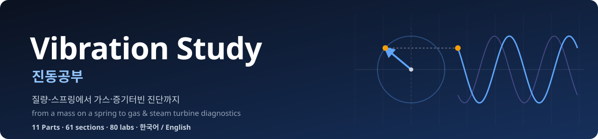
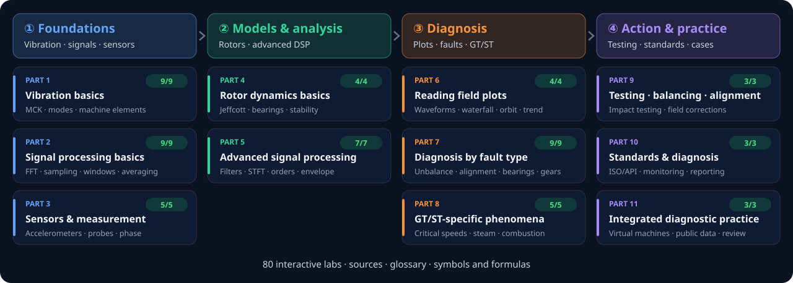
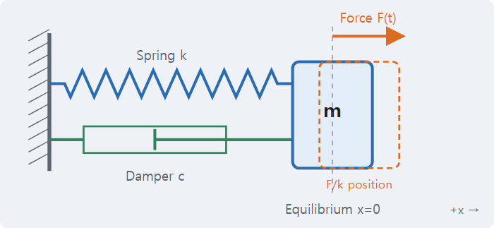
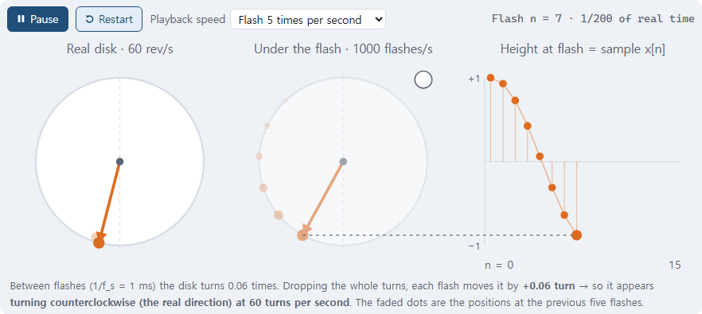
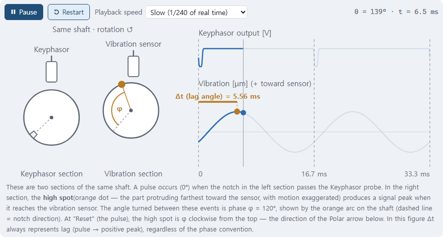
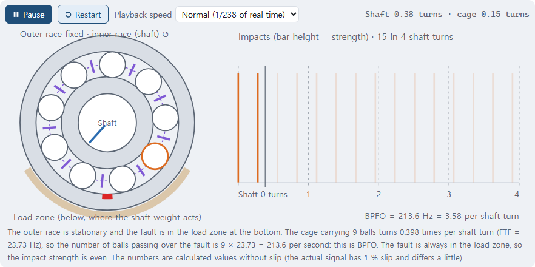
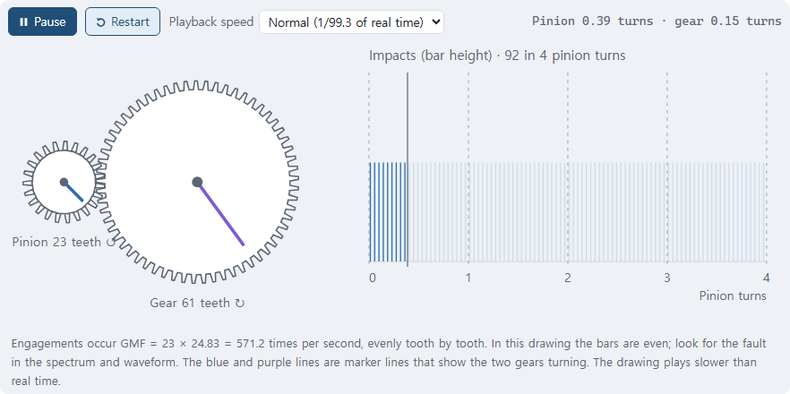
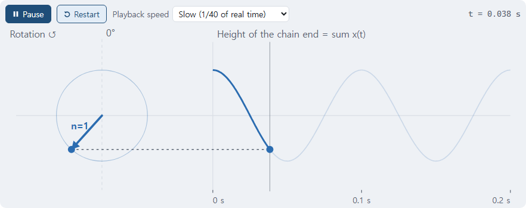

<p align="center">
  
</p>

<p align="center">
  <a href="README.md">한국어</a> · <b>English</b>
</p>

<p align="center">
  <a href="https://github.com/tg-jang03/Vibration_study/actions/workflows/deploy.yml"></a>
  
  
  
  
</p>

<h3 align="center">
  <a href="https://tg-jang03.github.io/Vibration_study/en/">Open the site</a> &nbsp;·&nbsp;
  <a href="https://tg-jang03.github.io/Vibration_study/en/lab/">Signal Lab</a> &nbsp;·&nbsp;
  <a href="https://tg-jang03.github.io/Vibration_study/en/reference/">Reference</a>
</h3>

<p align="center"><sub>All 11 Parts, 61 sections, 80 labs, figures and reference pages are available in English and Korean. Switch languages on any page.</sub></p>

<br>

> Vibration-diagnosis books tend to fall into one of two camps: equations that never meet a real field plot, or severity tables with no word on **why the plot looks that way**.
> This site bridges the two. It starts from a question, builds only the concepts it needs, and lets you check each one with a slider.

<table>
  <tr>
    <td width="33%" valign="top">
      <h3>📐 Physics to diagnosis</h3>
      Mass–spring and modes → DSP → sensors → rotordynamics → field plots → faults → GT/ST. Eleven Parts on one thread.
    </td>
    <td width="33%" valign="top">
      <h3>🎛️ 80 interactive labs</h3>
      Every concept has a lab, with a walkthrough before it and an interpretation after it. Strobed disks, bearings and gears actually spin.
    </td>
    <td width="33%" valign="top">
      <h3>✅ Numbers you can trust</h3>
      Calculation modules are checked against analytic solutions or reference values, including the numbers used in the figures.
    </td>
  </tr>
</table>

## Learning path

<p align="center">
  
</p>

<p align="center"><sub>As of 2026-10-13: all 61 sections and 80 labs are published in both languages. Browse the <a href="https://tg-jang03.github.io/Vibration_study/en/">English learning map</a> or <a href="https://tg-jang03.github.io/Vibration_study/">Korean learning map</a>.</sub></p>

## Signal Lab: labs you can play with

Build a virtual signal, change the settings, and use the formulas and readouts to see why the result comes out the way it does. Click a picture to open that lab.

<table>
  <tr>
    <td width="50%" valign="top">
      <a href="https://tg-jang03.github.io/Vibration_study/en/lab/frc-01/"></a>
      <b>LAB-FRC-01 · Forced vibration & resonance</b><br>
      <sub>The dashed box is where the same force would put the mass if applied slowly. With damping ratio 0.05 and forcing at the natural frequency, the steady-state amplitude is 10× larger and lags the force by a quarter-cycle.</sub>
    </td>
    <td width="50%" valign="top">
      <a href="https://tg-jang03.github.io/Vibration_study/en/lab/smp-01/"></a>
      <b>LAB-SMP-01 · Sampling & aliasing</b><br>
      <sub>A strobe-lit spinning disk. Why does 940 Hz look like 60 Hz, and turn backwards?</sub>
    </td>
  </tr>
  <tr>
    <td width="50%" valign="top">
      <a href="https://tg-jang03.github.io/Vibration_study/en/lab/phs-01/"></a>
      <b>LAB-PHS-01 · Keyphasor & phase</b><br>
      <sub>The notch passes and gives a pulse; the high spot arrives and gives a peak. The time difference Δt gives the phase relative to the once-per-revolution pulse.</sub>
    </td>
    <td width="50%" valign="top">
      <a href="https://tg-jang03.github.io/Vibration_study/en/lab/brg-02/"></a>
      <b>LAB-BRG-02 · Rolling-bearing faults</b><br>
      <sub>An impact every time a ball strikes the defect. Compare the even impacts of an outer-race defect with the 1X modulation of an inner-race defect.</sub>
    </td>
  </tr>
  <tr>
    <td width="50%" valign="top">
      <a href="https://tg-jang03.github.io/Vibration_study/en/lab/gear-01/"></a>
      <b>LAB-GEAR-01 · Gear faults</b><br>
      <sub>A 23/61-tooth pair in mesh. Switch from healthy to a broken tooth to add one big impact per turn.</sub>
    </td>
    <td width="50%" valign="top">
      <a href="https://tg-jang03.github.io/Vibration_study/en/lab/fou-01/"></a>
      <b>LAB-FOU-01 · Building harmonics</b><br>
      <sub>Start with a sine wave and add harmonics. The height of the rotating-arrow chain approaches a square wave.</sub>
    </td>
  </tr>
</table>

<p align="center"><a href="https://tg-jang03.github.io/Vibration_study/en/lab/"><b>See all 80 labs →</b></a></p>

## Reference: connect the concepts

The [reference hub](https://tg-jang03.github.io/Vibration_study/en/reference/) brings together a concept overview, [95 sources](https://tg-jang03.github.io/Vibration_study/en/reference/sources/), a [520-entry glossary](https://tg-jang03.github.io/Vibration_study/en/reference/glossary/) and [41 symbol and formula cards](https://tg-jang03.github.io/Vibration_study/en/reference/formulas/). Entries link back to the relevant course sections. The same reference pages are available in Korean.

## Principles

- **Start from a question.** Conversational text that only uses concepts from earlier pages.
- **A figure for every concept.** Each one is SVG drawn from computed values, not an AI image, and the numbers inside it are pinned by tests.
- **Pure functions for the math.** `src/lib/` has no DOM or React. It works in SI units internally and uses seeded random numbers.
- **Rules for moving figures.** 0° is up, rotation is counter-clockwise, and the height of the arrow tip is the signal. When something runs slower than real time, the slow-down ratio stays on screen.
- **Safe for a public repo.** ISO and API standards are summarized with citations, never reproduced. No company field data is used.

## How it is built

> **A human decides; AI agents build.**

The repo owner, a rotating-machinery vibration diagnostics engineer, decides what to learn and what counts as correct. [Claude Code](https://claude.com/claude-code) and Codex split the work into tracks and build pages, labs and figures on the same `main` branch.
They share one rulebook and use decision records (`D-xxx`), issues (`I-xxx`) and handoff notes as shared memory, kept as local working documents that are not committed to this repo.
Every push must pass type checking, tests, a build and English-content checks in GitHub Actions before it deploys. Separate headless-browser checks cover hydration, console errors, mobile overflow and animation playback.

## Run it locally

```bash
npm ci
npm run dev        # http://localhost:4321/Vibration_study/
```

Requires Node.js 22.12 or newer; CI uses Node.js 24. The English home is at `http://localhost:4321/Vibration_study/en/`.

`npm run check` checks types, `npm test` runs Vitest, and `npm run build` generates the static site. After building, `npm run verify:links` checks internal links and `npm run verify:i18n` checks English pages for untranslated Korean. `npm run i18n:status` reports missing or outdated translations.

For browser checks, start `npm run preview` in another terminal, then run:

```bash
npm run verify:page -- / /en/ /lab/frc-01/ /en/lab/frc-01/
```

<details>
<summary><b>Tech stack · repository layout</b></summary>
<br>

| | |
|---|---|
| Site | [Astro 7](https://astro.build) + MDX, static deploy to GitHub Pages |
| Labs | React 19 islands (`client:visible`) |
| Plots & math | Plotly (cartesian), KaTeX |
| Computation | Pure TypeScript functions: FFT, filters, rotor models, fault-signal synthesis |
| Checks | Vitest, `astro check`, headless-Edge page checks, link checks |

| Path | Contents |
|---|---|
| `src/pages/p{Part}-{section}.mdx` · `src/pages/en/` | Korean course pages and English routes/pages |
| `src/pages/lab/[slug].astro` · `src/pages/en/lab/` | Standalone labs in both languages (Signal Lab) |
| `src/pages/reference/` · `src/components/site/` | Reference routes and shared site pages |
| `src/i18n/` · `src/i18n/en/` | Language routing, UI strings, English lab/figure/glossary dictionaries |
| `src/components/labs/` · `ui/` | Lab components · shared parts (`LabFrame`, `Plot`, `PhasorView`, `PlayControls` …) |
| `src/lib/` | Calculation modules (`dsp`, `mck`, `rotor`, `faults`, `machine` …) and tests |
| `src/figures/` | SVG figure data for the pages, with tests |
| `src/data/` | Course outline (`curriculum.ts`), lab list, references, glossary (`glossary.md`) |

</details>

<br>

<p align="center"><sub>A personal study site, published openly · If you spot an error, an issue report is very welcome</sub></p>
