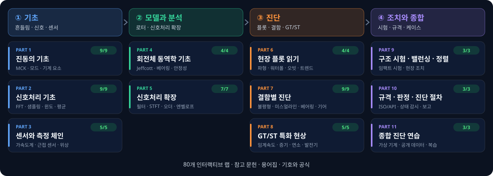
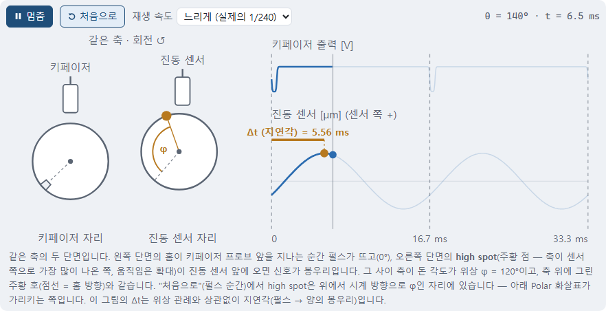

  

  <b>한국어</b> · <a href="README.en.md">English</a>

<h3 align="center">
  <a href="https://tg-jang03.github.io/Vibration_study/">사이트 열기</a> &nbsp;·&nbsp;
  <a href="https://tg-jang03.github.io/Vibration_study/lab/">Signal Lab</a> &nbsp;·&nbsp;
  <a href="https://tg-jang03.github.io/Vibration_study/reference/">레퍼런스</a>
</h3>

11개 Part · 61절 · 80개 랩 · 본문·그림·레퍼런스까지 한국어와 영어로 읽을 수 있습니다. 각 페이지에서 언어를 전환하세요.

 

**기계 진동 분석과 회전체 진단**을 처음부터 차례로 익히는 웹 학습서입니다. 진동의 물리와 신호처리부터 대형 회전기계(가스터빈·증기터빈, GT/ST)의 상태 진단까지, 그림과 수식, 직접 만져 보는 랩으로 하나의 흐름 안에서 배웁니다.

> 진동 진단 책은 식만 많아 현장 플롯과 안 이어지거나, 판정표만 있고 **"왜 그렇게 보이나"** 가 빠져 있습니다.
> 이 학습서는 그 사이를 잇습니다 — 질문에서 출발해, 필요한 개념만 쌓고, 슬라이더로 직접 확인합니다.

<table>
  <tr>
    <td width="33%" valign="top">
      <h3>📐 물리에서 진단까지</h3>
      MCK·모드 → 신호처리 → 센서 → 로터다이내믹스 → 현장 플롯 → 결함 → GT/ST. 한 줄로 이어지는 11개 Part.
    </td>
    <td width="33%" valign="top">
      <h3>🎛️ 80개의 인터랙티브 랩</h3>
      개념마다 랩이 있고, 앞에는 따라 하기, 뒤에는 해석. 회전 원판·베어링·기어가 실제로 돕니다.
    </td>
    <td width="33%" valign="top">
      <h3>🧭 질문에서 출발</h3>
      절마다 질문 하나로 시작해, 앞에서 배운 개념만으로 답을 쌓아 갑니다. 개념마다 그림이 따라옵니다.
    </td>
  </tr>
</table>

## 학습 경로

  

네 단계로 나뉜 11개 Part가 각자 하나의 질문에 답합니다. Part 이름을 누르면 그 Part의 절 목록이 열립니다.

| Part | 이 Part가 답하는 질문 |
|---|---|
| **① 기초** — 흔들림 · 신호 · 센서 | |
| [1 · 진동의 기초](https://tg-jang03.github.io/Vibration_study/parts/1/) | 기계는 왜, 어떻게 흔들리나? |
| [2 · 신호처리 기초](https://tg-jang03.github.io/Vibration_study/parts/2/) | 분석기 설정 하나하나가 스펙트럼을 어떻게 바꾸나? |
| [3 · 센서와 측정 체인](https://tg-jang03.github.io/Vibration_study/parts/3/) | 이 숫자는 무엇을, 얼마나 믿을 만하게 쟀나? |
| **② 모델과 분석** — 로터 · 신호처리 확장 | |
| [4 · 회전체 동역학 기초](https://tg-jang03.github.io/Vibration_study/parts/4/) | 회전체는 무엇이 다르고, 언제 스스로 흔들리나? |
| [5 · 신호처리 확장](https://tg-jang03.github.io/Vibration_study/parts/5/) | 묻혀 있는 결함 신호를 어떻게 꺼내나? |
| **③ 진단** — 플롯 · 결함 · GT/ST | |
| [6 · 현장 플롯 읽기](https://tg-jang03.github.io/Vibration_study/parts/6/) | 각 플롯은 무엇을 보여주고 무엇을 숨기나? |
| [7 · 결함별 진단](https://tg-jang03.github.io/Vibration_study/parts/7/) | 이 패턴은 어떤 결함 메커니즘을 가리키나? |
| [8 · GT/ST 특화 현상](https://tg-jang03.github.io/Vibration_study/parts/8/) | 우리 기계의 기동·운전 중 현상을 어떻게 해석하나? |
| **④ 조치와 종합** — 시험 · 규격 · 케이스 | |
| [9 · 구조 시험 · 밸런싱 · 정렬](https://tg-jang03.github.io/Vibration_study/parts/9/) | 원인을 어떻게 확인하고 어떻게 고치나? |
| [10 · 규격 · 판정 · 진단 절차](https://tg-jang03.github.io/Vibration_study/parts/10/) | 얼마나 나쁜가, 어떻게 판단하고 보고하나? |
| [11 · 종합 진단 연습](https://tg-jang03.github.io/Vibration_study/parts/11/) | 처음 보는 데이터에서 결함을 찾을 수 있나? |

## 이렇게 읽습니다

- **처음이라면 Part 1부터 차례로.** 각 절은 앞 절까지 나온 개념만 쓰므로, 막히면 앞 절로 돌아가면 됩니다. 필요한 주제만 찾는다면 [학습 지도](https://tg-jang03.github.io/Vibration_study/)에서 바로 그 절로 가도 됩니다.
- **질문 → 개념과 그림 → 랩 → 해석.** 한 절은 질문 하나에서 출발해 개념을 하나씩 그림과 함께 쌓고, 랩에서 직접 확인합니다. 랩 앞의 따라 하기가 무엇을 움직여 볼지, 랩 뒤의 해석이 무엇을 봤어야 하는지 알려 줍니다.
- **모르는 말은 레퍼런스에서.** 처음 보는 용어는 용어집, 기호와 식은 기호·공식 카드에서 다시 찾고, 그 개념을 처음 설명한 절로 돌아갈 수 있습니다.

## Signal Lab — 직접 움직여 보는 랩

가상 신호를 만들고, 설정을 바꾸고, 결과가 왜 그렇게 나오는지 식과 읽음값으로 확인합니다. 그림을 누르면 그 랩이 열립니다.

<table>
  <tr>
    <td width="50%" valign="top">
      
      <b>LAB-FRC-01 · 강제진동과 공진</b> 
      점선 상자는 같은 힘을 천천히 걸었을 때의 자리. 감쇠비 0.05에서 가진 주파수를 고유진동수에 맞추면, 정상상태 진폭은 10배이고 힘보다 1/4주기 늦습니다.
    </td>
    <td width="50%" valign="top">
      
      <b>LAB-SMP-01 · 샘플링과 에일리어싱</b> 
      스트로브로 본 회전 원판. 940 Hz가 왜 60 Hz로, 그것도 거꾸로 도는 것처럼 보일까요?
    </td>
  </tr>
  <tr>
    <td width="50%" valign="top">
      
      <b>LAB-PHS-01 · 키페이저와 위상</b> 
      홈이 지나면 펄스, high spot이 오면 봉우리. 그 사이 시간차 Δt로 한 바퀴에 한 번 나오는 펄스 기준의 위상을 구합니다.
    </td>
    <td width="50%" valign="top">
      
      <b>LAB-BRG-02 · 구름베어링 결함</b> 
      볼이 결함을 칠 때마다 충격. 외륜 결함의 고른 충격과 내륜 결함의 1X 변조를 비교해 보세요.
    </td>
  </tr>
  <tr>
    <td width="50%" valign="top">
      
      <b>LAB-GEAR-01 · 기어 결함</b> 
      맞물려 도는 23·61이빨 기어. 정상에서 깨진 이로 바꾸면 한 바퀴에 한 번 큰 충격이 더해집니다.
    </td>
    <td width="50%" valign="top">
      
      <b>LAB-FOU-01 · 하모닉 쌓기</b> 
      1차 사인파에 하모닉을 더해 보세요. 도는 화살표 사슬 끝의 높이가 사각파에 가까워집니다.
    </td>
  </tr>
</table>

<a href="https://tg-jang03.github.io/Vibration_study/lab/"><b>랩 80개 모두 보기 →</b></a>

## 레퍼런스 — 배운 개념을 다시 찾기

[레퍼런스 허브](https://tg-jang03.github.io/Vibration_study/reference/)에는 개념 개요, [참고 문헌 95개](https://tg-jang03.github.io/Vibration_study/reference/sources/), [용어집 520항목](https://tg-jang03.github.io/Vibration_study/reference/glossary/), [기호·공식 카드 41개](https://tg-jang03.github.io/Vibration_study/reference/formulas/)가 있습니다. 항목에서 관련 본문으로 돌아갈 수 있고, [영어 레퍼런스](https://tg-jang03.github.io/Vibration_study/en/reference/)도 같은 구성으로 제공합니다.

 

개인 학습용 공개 사이트입니다 · 내용의 오류는 이슈로 알려 주시면 고맙겠습니다

